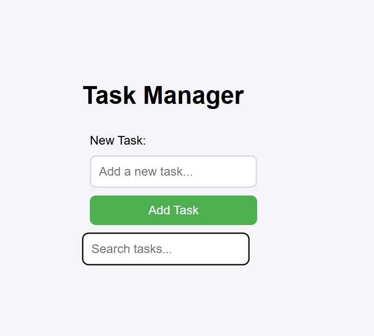

# 📝 Task Manager App

A React Task Manager that demonstrates global state management using Context API and React Hooks.

---

## 🚀 Features

- Add tasks using `useId`
- Mark tasks as completed using `useContext`
- Search tasks dynamically using `useRef`
- Global state management via Context API
- Backend integration with JSON Server

---

## 📸 Application Screenshot

### 👉 Your final UI output goes here:



> If the image does not appear, ensure it is saved in: `./react-hooks-task-manager-lab.png`

---

## 🧠 Tech Stack

- React
- Context API
- useState / useEffect
- useRef
- useId
- JSON Server

---

## 📦 Setup Instructions

```bash id="setup1"
npm install


